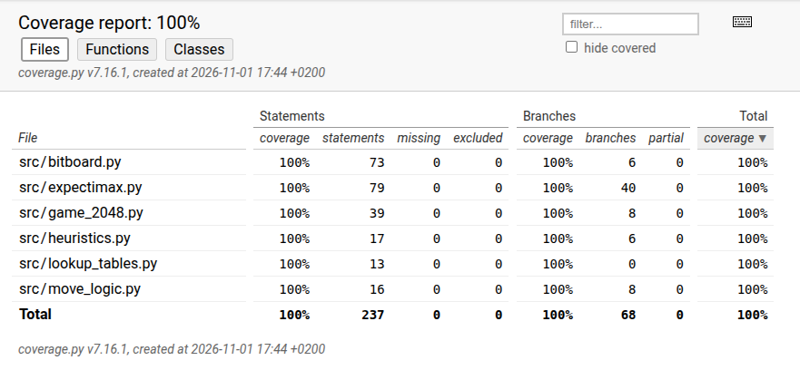
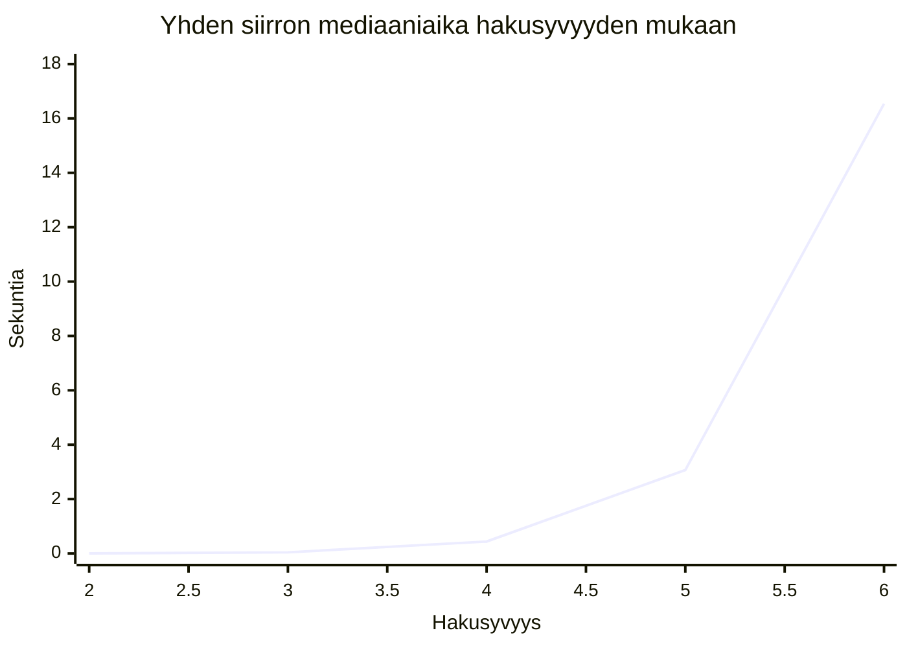

# Testausdokumentti

## Yksikkötestauksen kattavuus

Projektin yksikkötestit kattavat testatun ydinkoodin. Testien haaraumakattavuus on 100%.
Käyttöliittymän käynnistysfunktioita ja suorituskykymittausskriptiä ei
ole sisällytetty tähän kattavuuslukuun, sillä niitä ei ole tarkoituksenmukaista
testata samalla tavalla kuin algoritmin ydintoimintoja.



Kattavuusprosentti kertoo, että testit suorittavat lähdekoodin rivit, mutta se
ei yksin todista kaikkien mahdollisten syötteiden oikeellisuutta. Siksi
raportissa kuvataan myös testien konkreettiset syötteet ja odotetut tulokset.

## Mitä testattiin ja miten?

Testit toteutettiin Pythonin `unittest`-kirjastolla. Nykyinen testikokoelma
sisältää 40 testiä.

### Pelilaudan bittitaulu

`bitboard_test.py` testaa muun muassa:

* solun asettamista ja lukemista sekä bittien lukemista
* 64-bittisen lautaarvon muodostumista
* tyhjien solujen löytämistä
* rivin asettamista ja lukemista
* vasemmalle, oikealle, ylös ja alas siirtämistä
* virheellisen siirtosuunnan hylkäämistä `ValueError`-poikkeuksella
* laudan merkkijonoesitystä.

Esimerkiksi rivin `[1, 1, 2, 2]` siirto vasemmalle tuottaa eksponenttirivin
`[2, 3, 0, 0]`. Tämä vastaa laattojen `2, 2, 4, 4` yhdistämistä laatoiksi
`4, 8`.

### Rivin siirtäminen ja yhdistäminen

`move_logic_test.py` testaa:

* nollien poistamista riviltä
* samanarvoisten vierekkäisten laattojen yhdistämistä
* neljän laatan yhdistämistä kahdeksi laataksi
* käänteistä eli oikealle suuntautuvaa käsittelyä.

Testisyötteinä käytetään muun muassa rivejä `[2, 2, 2, 2]`,
`[3, 3, 4, 4]` ja `[0, 0, 2, 2]`. Testit tarkistavat sekä yhdistetyn
eksponentin että laattojen oikean järjestyksen.

### Pelilogiikka

`game_2048_test.py` testaa:

* uuden pelin alkutilan: kaksi laattaa ja nollapisteet
* pelin alustamisen uudelleen `reset`-metodilla
* kahden `2`-laatan yhdistämisen `4`-laataksi ja pistemäärän kasvun neljään
* siirron, joka ei muuta lautaa
* uuden laatan lisäämisen tyhjälle laudalle
* täyden laudan tilanteen, jossa uutta laattaa ei voida lisätä
* yksittäisten laattojen muodostaman pistemäärän.

Satunnaisuutta hallitaan osassa testeistä `random.Random(0)`-generaattorilla.
Näin testit ovat toistettavia, vaikka uuden laatan paikka valitaan satunnaisesti.

Satunnaisen laatan toimintaa voidaan havainnoida myös peliä pelaamalla. Kun
laillinen siirto muuttaa pelilautaa, laudalle ilmestyy yksi uusi laatta
tyhjään ruutuun. Uuden laatan arvoksi voidaan havaita joko 2 tai 4: 2-laattoja
ilmestyy selvästi useammin kuin 4-laattoja. Yksittäinen peli ei kuitenkaan
riitä todentamaan jakaumaa tilastollisesti, vaan havainto kertoo lähinnä, että
uuden laatan luominen ja sen arvo toimivat odotetulla tavalla.

### Heuristiikka

`heuristics_test.py` laskee odotetun heuristisen arvon itse ja vertaa sitä
`Heuristics.evaluate`-metodin palauttamaan arvoon. Testeissä käytetään:

* tyhjää lautaa
* lautaa, jossa laatat ovat indekseissä 0, 5 ja 15
* täyttä lautaa
* täyttä lautaa, jossa vierekkäisiä samanarvoisia laattoja ei ole.

Lisäksi tarkistetaan, että täydelle pelilaudalle, jolla ei ole laillisia
siirtoja, palautetaan `GAME_OVER_PENALTY`.

### Expectimax

Expectimaxin testit käyttävät testiheuristiikkaa, joka palauttaa arvon
`2 * 4 ** 15`, jos laudalla on eksponentiltaan 7 oleva laatta eli 128-laatta,
ja muuten arvon `0.0`. Voittoarvo ylittää testilaudalla mahdolliset normaalit
heuristiset arvot.

Testit tarkistavat seuraavat tilanteet:

1. Testiheuristiikan voittoarvo on suurempi kuin `4 ** 15` ja `2 ** 16 * 64`.
2. Laudalla, jossa vain `left` mahdollistaa kahden 64-laatan yhdistämisen
   seuraavalla siirtotasolla, `get_best_move` palauttaa `left`.
3. Laudalla, jossa kaksi eri siirtoa asettaa 64-laatat vierekkäin, testin
   odotettu siirtojoukko on `["left", "down"]`.
4. Hakusyvyys kasvaa tyhjien ruutujen vähentyessä. Rajatapaukset 11, 7, 3
   ja 2 tyhjää ruutua tuottavat vastaavasti syvyydet 3, 4, 5 ja 6.
5. Virheelliset syvyysparametrit, kuten `(1, 2)`, `(2, 1)`, `(2, 7)` ja
   `(7, 7)`, aiheuttavat `ValueError`-poikkeuksen.
6. Max-solmu käyttää annettua hakusyvyyttä, arvioi syvyyden nolla tilanteen
   heuristiikalla, käyttää välimuistissa olevaa arvoa, arvioi laudan ilman
   laillisia siirtoja ja kutsuu chance-solmua syvemmällä haulla.
7. Chance-solmu arvioi syvyyden nolla tilanteen, käyttää välimuistia ja
   palauttaa heuristisen arvon peliin päättyneestä tai täydestä laudasta.

Näissä testeissä käytetään `unittest.mock.Mock`-olioita tarkistamaan myös
heuristiikan, hakusyvyyden ja chance-solmun kutsumista.

## Testien toistaminen

Testit voidaan ajaa projektin juuressa projektin Invoke-taskilla:

```text
poetry run invoke test
```

Tehtävä suorittaa `pytest`-testit `src`-hakemistossa. Onnistuneessa ajossa
kaikki 40 testiä läpäisevät.

Kattavuusraportti muodostetaan projektin omilla Invoke-taskeilla:

```text
poetry run invoke coverage
poetry run invoke coverage-report
```

Ensimmäinen komento suorittaa testit haarakattavuuden kanssa ja toinen luo
HTML-raportin. Kattavuustyökalu ei välttämättä ole asennettuna kaikissa
projektin virtuaaliympäristöissä. Tämä ei estä yksikkötestien ajamista
`unittest`-kirjastolla.

## Empiirinen suorituskykytestaus

Yhden siirron suorituskykyä mitattiin
[`expectimax_depth_benchmark.py`](../src/expectimax_depth_benchmark.py)
-ohjelmalla. Sama lähtölauta tutkittiin kolme kertaa kullakin kiinteällä
hakusyvyydellä, ja tuloksena käytettiin ajoaikojen mediaania.

| Hakusyvyys | Mediaaniaika | Siirto |
|---:|---:|---|
| 2 | 0,002 s | `left` |
| 3 | 0,042 s | `left` |
| 4 | 0,439 s | `left` |
| 5 | 3,068 s | `left` |
| 6 | 16,539 s | `left` |



Hakusyvyys 2–6 kasvatti yhden siirron mediaaniajan noin 0,002 sekunnista
16,539 sekuntiin. Tämä havainnollistaa hakupuun eksponentiaalista kasvua.
Mittaus perustuu yhteen lähtölautaan ja kolmeen toistoon hakusyvyydellä,
joten se on suuntaa-antava eikä yleinen laitteistojen välinen vertailu.

Algoritmia ajettiin lisäksi kokonaisina peleinä kymmenen kertaa kullakin
`min_depth-max_depth`-asetuksella. Alla olevat ajat, siirrot ja pisteet ovat
ajoista laskettuja keskiarvoja.

| Hakusyvyys | Keskimääräinen aika | Keskimääräinen siirtojen määrä | Keskimääräinen pistemäärä |
|---|---:|---:|---:|
| 2-2 | 0:02 | 1 151 | 20 905 |
| 2-4 | 14:25 | 3 061 | 66 824 |
| 4-4 | 15:06 | 3 283 | 72 260 |
| 2-6 | 5:39:00 | 4 505 | 103 475 |
| 4-6 | 6:25:00 | 5 180 | 121 572 |

Suurempi mahdollinen hakusyvyys paransi näissä ajoissa keskimääräistä
pistemäärää ja siirtojen määrää, mutta kasvatti suoritusaikaa voimakkaasti.
Tuloksista ei voi päätellä, että parempi tulos johtuisi nimenomaan
dynaamisesta syvyyden valinnasta, koska `2-6`- ja `4-6`-asetuksilla on
suurempi maksimihakusyvyys kuin vastaavilla kiinteillä asetuksilla.

Kokonaispelien mittaukset ovat satunnaisuuden vuoksi suuntaa-antavia.
Vertailukelpoisempi koe vaatisi saman laitteen, saman Python-ympäristön ja
ennalta määrätyt satunnaissiemenet.

## Testauksen rajaukset

Testit ovat toiminnallisia yksikkötestejä eivätkä pelkästään rivikattavuuden
saavuttamiseksi tehtyjä testejä. Ne käyttävät ennalta rakennettuja
lautatilanteita ja tarkistavat tunnetut odotetut tulokset.

Seuraavia osia ei ole testattu erillisinä yksikkötesteillä:

* `main.py`: `main`- ja `_game_summary`-funktiot lukevat käyttäjän syötettä
  ja tulostavat tietoja. Niiden testaaminen vaatisi käyttöliittymän syötteen ja
  tulosteen erillistä simulointia.
* `human_playtest.py`: `human_playtest` on interaktiivinen komentoriviohjelma,
  jonka syötteenlukua ei testata automaattisilla yksikkötesteillä.
* `expectimax_depth_benchmark.py`: tiedosto on suorituskykymittausskripti,
  ei algoritmin ydintoteutus. Sen käyttämät `Expectimax`-metodit testataan
  erikseen, ja skriptin toiminta varmistetaan suorittamalla benchmark.
* `lookup_tables.py`-moduulin yksityisiä hakutaulukoiden alustusrutiineja ei
  testata erillisinä yksikkötesteillä. Ne suoritetaan epäsuorasti
  `Bitboard`-siirtotestien kautta, kun hakutaulukoita käytetään laudan
  siirtämiseen.
* `src/tests/__init__.py` ei sisällä suoritettavaa toiminnallisuutta.

Erillistä koko pelin alusta loppuun suorittavaa integraatiotestiä ei ole,
koska Expectimaxin päätöksentekoa voidaan testata deterministisesti
testiheuristiikan avulla. Testiheuristiikka ei kuitenkaan korvaa koko
`Game2048`- ja `Expectimax`-ketjun satunnaisuustestausta.
